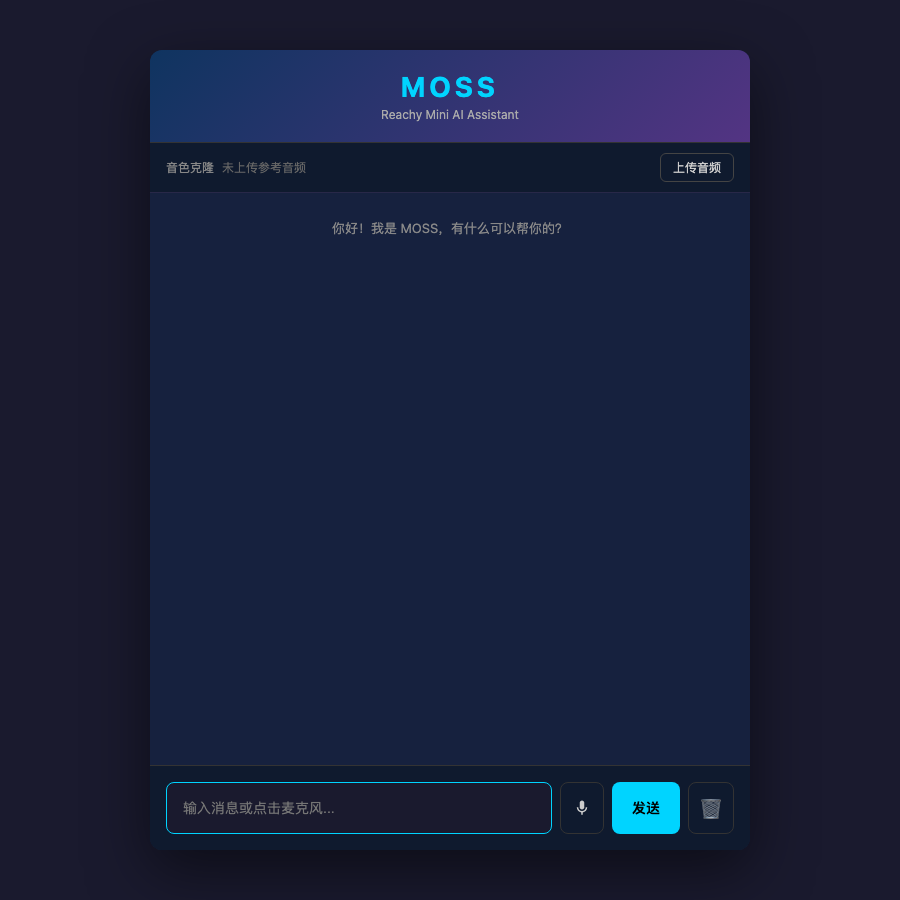

# mossy

MOSS is a Reachy Mini conversational AI app with a local web UI, OpenAI-compatible
LLM calls, Mosi ASR, and Mosi TTS streaming playback.

## Runtime UI

The screenshot below was captured from the running FastAPI UI at
`http://127.0.0.1:7863/`.



## Requirements

- Python 3.10+
- A Reachy Mini runtime environment
- API credentials for:
  - `MOSI_TTS_API_KEY`
  - `MOSI_ASR_API_KEY`
  - `LLM_API_KEY`

The default LLM endpoint is DeepSeek's OpenAI-compatible API. Override
`LLM_BASE_URL` and `LLM_MODEL` when using Ollama, vLLM, SGLang, or another
compatible backend.

## Setup

```bash
python -m venv .venv
source .venv/bin/activate
python -m pip install -e ".[dev]"
cp .env.example .env
```

Edit `.env` and fill the required keys before running the app.

## Run

Load the environment variables and start the Reachy Mini app entrypoint:

```bash
set -a
source .env
set +a
mossy
```

The web UI listens on `MOSS_WEB_UI_PORT`, defaulting to `7863`.

For UI-only local verification without robot hardware, start the FastAPI server
directly:

```bash
set -a
source .env
set +a
PYTHONPATH=src python -c 'from mossy.main import Moss; Moss()._run_server()'
```

Then open `http://127.0.0.1:7863/`.

## Configuration

| Variable | Default | Purpose |
| --- | --- | --- |
| `MOSI_TTS_API_KEY` | required | Mosi TTS API key |
| `MOSI_TTS_BASE_URL` | `https://api.mosi.cn` | Mosi TTS endpoint |
| `MOSI_ASR_API_KEY` | required | Mosi ASR API key |
| `MOSI_ASR_BASE_URL` | `https://studio.mosi.cn` | Mosi ASR endpoint |
| `LLM_API_KEY` | required | OpenAI-compatible API key |
| `LLM_BASE_URL` | `https://api.deepseek.com` | OpenAI-compatible base URL |
| `LLM_MODEL` | `deepseek-chat` | Chat model name |
| `MOSS_WEB_UI_PORT` | `7863` | Local web UI port |
| `MOSS_AUDIO_GAIN` | `3.0` | TTS playback gain before clipping |
| `MOSS_SYSTEM_PROMPT` | see `.env.example` | System prompt for short spoken replies |

## Checks

```bash
make check
```

`make check` runs:

- `ruff check src`
- `ruff format --check src`
- `python -m compileall -q src/mossy`

Install the local pre-commit hooks with:

```bash
pre-commit install
```
