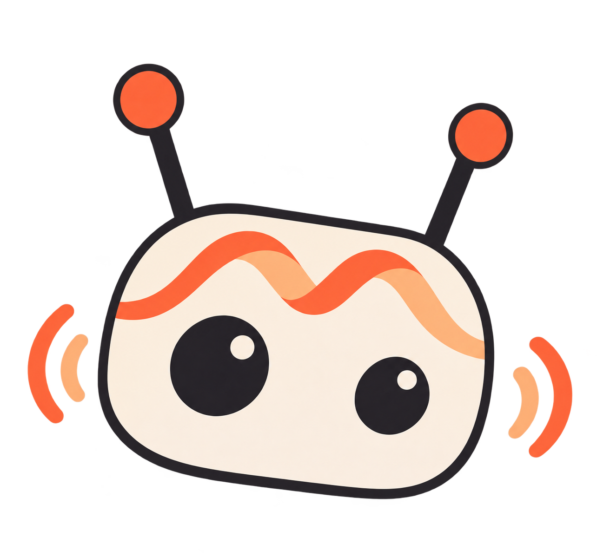

<p align="center">
  
</p>

<h1 align="center">mossy</h1>

Voice and visual conversations with expressive motion for Reachy Mini, powered by the
[MOSS-Live public API](https://platform.moss.cn/docs/scenarios/moss-live/).

MOSS-Live handles speech recognition, conversation and speech generation. mossy
streams the robot's microphone, optional onboard camera input and speaker audio,
manages playback and interruptions, and adds local gestures using official Reachy
motion recordings.

- Real-time voice conversation with `moss-live-1.0`.
- Optional full-duplex conversation with interruption support.
- Visual questions using frames from Reachy Mini's onboard camera.
- Happy, agreeing, thinking and listening gestures, alongside speech-driven head wobbling.
- A local page for transcripts, connection state, microphone mute and expression controls.

Vision is opt-in. When enabled, JPEG frames from the robot's camera are sent to
MOSS-Live on the same connection as audio. The app reads the Reachy SDK camera
feed; it does not select a laptop webcam as a fallback.

## Quick start

The steps below run mossy from a terminal on the computer connected to the robot.
The tested hardware setup is Reachy Mini Lite on macOS, Python 3.12 and Reachy Mini
SDK 1.8.4. Package metadata allows Python 3.10+, while CI uses Python 3.12.

### 1. Prepare the robot

Connect the robot, switch on its independent power supply, and start its daemon
using Reachy Mini Control or your existing Reachy runtime. For a local Lite setup,
the daemon dashboard is at <http://127.0.0.1:8000/>. Stop any other app using the
robot before launching mossy.

See the [official Reachy installation guide](https://huggingface.co/docs/reachy_mini/SDK/installation)
for SDK, media dependencies and platform permissions. Starting mossy requires an
already-running daemon.

### 2. Install mossy

From the repository root, using a Python 3.12 interpreter:

```bash
python3.12 -m venv .venv
source .venv/bin/activate
python -m pip install -e .
```

### 3. Configure the API key

Create the local configuration file, then edit it to set `MOSS_API_KEY`:

```bash
mkdir -p ~/.config/mossy
chmod 700 ~/.config/mossy
cp -n .env.example ~/.config/mossy/.env
chmod 600 ~/.config/mossy/.env
```

`cp -n` preserves an existing configuration. The app loads settings in this order
(highest priority first):

1. Exported environment variables.
2. `~/.config/mossy/.env`.
3. `.env` in the process's working directory.
4. Defaults in [config.py](src/mossy/config.py).

A valid MOSS API key is required. It is sent in the WebSocket Authorization
header, and is not returned by the status page. Keep real keys in the local
configuration or environment; `.env.example` contains no key.

### 4. Download expression recordings

With the virtual environment still active, preload the exact official dataset
revisions used by this app:

```bash
python - <<'PY'
from huggingface_hub import snapshot_download
from mossy.expressions import LIBRARIES

for dataset, (revision, _) in LIBRARIES.items():
    snapshot_download(dataset, repo_type="dataset", revision=revision)
PY
```

Run this as the same OS user that will run mossy so the cache is available to the
app. Expressions load recordings from local cache only. Missing recordings
make expressions unavailable while voice continues to work. To use voice alone,
set `MOSS_EXPRESSIONS=0`.

### 5. Start talking

```bash
mossy
```

Open <http://127.0.0.1:7863/> on the computer running mossy. The page shows live
transcripts, connection state and the current gesture, with buttons to mute the
microphone, toggle expressions and enable visual input. Talking to the robot does
not require keeping the page open.

Stop a terminal-launched app with `Ctrl+C`. MOSS-Live bills from session attachment
until the WebSocket closes; muting or closing the browser keeps the session
connected. See the [MOSS-Live guide](https://platform.moss.cn/docs/scenarios/moss-live/)
for session and billing behaviour.

## Launching from Reachy Mini Control

Reachy Mini Control uses its own app environment. An installation into the
repository's `.venv` is for terminal use and does not add mossy to that environment.

On macOS, after Control has initialized its app environment, install from the
repository root with [uv](https://docs.astral.sh/uv/):

```bash
REACHY_APPS_PYTHON="$HOME/Library/Application Support/com.pollen-robotics.reachy-mini/apps_venv/bin/python"
uv pip install --python "$REACHY_APPS_PYTHON" .
```

Then start `mossy` from the installed apps list in Control or the running daemon's
dashboard, and stop it there when finished. It reads the same
`~/.config/mossy/.env` and Hugging Face cache for that OS user. Use the matching app
environment for other Reachy deployment types; the path above is macOS-specific.

## Voice, vision and expressions

### Conversation mode

The default is **half duplex** (`MOSS_HALF_DUPLEX=1`): while the robot speaks, and
for 350 ms afterwards, microphone input is replaced with silence. Manual mute
also sends silence so the realtime input stream keeps running.

For **full duplex**, set this in the local configuration and restart mossy:

```dotenv
MOSS_HALF_DUPLEX=0
```

The microphone then remains active during replies, allowing you to interrupt.
If speaker echo causes the robot to interrupt itself, use half duplex while
checking the audio setup. Echo handling depends on the Reachy runtime and device.

### Visual questions

Click **开启视觉** on the local status page, or set `MOSS_CAMERA=1` in the local
configuration and restart mossy. Point Reachy Mini at an object and ask a question
aloud, for example “你面前是什么，是什么颜色？”. The page shows the robot's current
view and the number of frames sent to MOSS.

The default is 1 frame per second, JPEG quality 80 and a maximum image edge of
640 pixels. Capture and encoding run separately from audio; only the latest frame
is queued and old frames are dropped. Audio stays active when visual input is
disabled. Frames are kept in memory for preview and are not saved by the app.

Preview and camera controls are available only from a local browser on the machine
running mossy. **关闭视觉** stops frame uploads and clears the preview; it does not
turn off the camera hardware used by the Reachy daemon. The browser switch affects
the current process; use `MOSS_CAMERA` for the persistent setting.

On macOS, the app launching the Reachy daemon needs Camera permission even for
the robot's USB camera. Allow the relevant launcher, such as Reachy Mini Control
or Terminal, in System Settings → Privacy & Security → Camera. Restart the daemon
from that authorized launcher if it previously failed to open the camera. Camera
failure leaves voice available and is shown in the status page.

### Expression behaviour

| Behaviour | Trigger | Official recording |
| --- | --- | --- |
| Happy | Explicit positive replies such as “太好了！” or “恭喜你…” | `groovy_sway_and_roll` |
| Agree | Acknowledgements such as “好的…” or “没问题。” | `simple_nod` |
| Thinking | A pause after the user's transcription, or “让我想想。” | `thoughtful1` |
| Listening | User transcription while the assistant is not speaking | `attentive1` |

Reply gestures use conservative rules on the first complete Chinese sentence,
with a final short reply also eligible. Questions, quoted speech and matched
negative expressions stay neutral. The rules cover explicit expressions;
sarcasm and nuanced sentiment are outside their current coverage.

Gestures are short, amplitude-limited and subject to cooldowns. A reply gesture
can start once that response's local audio begins playing, at most once per
response; late triggers are skipped. Interruptions cancel the matching gesture
and return its target toward neutral; old response events do not cancel a newer
response's gesture. Recorded
sound effects are not played over the conversation.

The page's expression toggle applies to the current process and keeps voice and
speech wobbling active. For a persistent change, set `MOSS_EXPRESSIONS=0` and
restart. Motion worker errors are shown in `/state`; voice can continue without
expressions. Exact limits and dataset revisions live in
[expressions.py](src/mossy/expressions.py).

## Configuration reference

Restart mossy after changing environment settings. The page controls microphone
mute and expressions at runtime.

| Variable | Default | Purpose |
| --- | --- | --- |
| `MOSS_API_KEY` | required | API credential |
| `MOSS_HALF_DUPLEX` | `1` | `0` enables listening during replies |
| `MOSS_EXPRESSIONS` | `1` | Enable conversation gestures |
| `MOSS_EXPRESSION_INTENSITY` | `0.45` | Gesture amplitude, from `0` to `1` |
| `MOSS_CAMERA` | `0` | Send the robot's camera frames to MOSS-Live |
| `MOSS_CAMERA_FPS` | `1` | Capture/send rate, from `0.5` to `5` FPS |
| `MOSS_CAMERA_MAX_EDGE` | `640` | Maximum JPEG width or height, from `128` to `1920` pixels |
| `MOSS_CAMERA_JPEG_QUALITY` | `80` | JPEG quality, from `1` to `95` |
| `MOSS_AUDIO_GAIN` | `1.0` | Software playback gain before clipping |
| `MOSS_WEB_UI_PORT` | `7863` | Status page port on the machine running mossy |
| `MOSS_LIVE_NAME` | `MOSS` | Assistant name used for address recognition |
| `MOSS_LIVE_PROMPT` | empty | Optional replacement persona prompt |
| `MOSS_LIVE_INSTRUCTIONS` | `请用简洁自然的中文回答。` | Session instructions |
| `MOSS_LIVE_URL` | `https://api.mosi.cn` | API origin; the client adds `/v1/realtime` |
| `MOSS_LIVE_MODEL` | `moss-live-1.0` | Model query parameter |
| `MOSS_LIVE_VOICE_ID` | empty | Optional platform voice ID; wait for `voice_changed` before enabling input, and reapply on reconnect |
| `MOSS_LIVE_USER` | `reachy-mini` | Stable user ID used on reconnect |
| `MOSS_LIVE_VERIFY_TLS` | `1` | Verify the API server certificate |

Setting only the assistant name retains the server's default persona prompt.
See [.env.example](.env.example) for the complete template, including local proxy
bypass settings.

## Troubleshooting and current limits

| Symptom | What to check |
| --- | --- |
| Cannot connect to the robot | Confirm the daemon is running and the robot has independent power. The local dashboard is a separate service on port `8000`. |
| Local SDK connection fails with a proxy enabled | Include `localhost,127.0.0.1,::1` in `NO_PROXY` and `no_proxy`; preserve any other bypass hosts you need. The MOSS API connection itself uses a direct WebSocket connection. |
| No reply sound | Check the robot output device and its speaker volume in the daemon dashboard. `MOSS_AUDIO_GAIN` is software gain, not the device volume. |
| Expressions are unavailable | Run the recording download step under the app's OS user and inspect `expressions.error` in `/state`. |
| Visual input shows no frames | Check Reachy's camera connection and the daemon launcher's Camera permission. `camera.captured_frames` reports capture, while `camera.sent_frames` reports uploads; voice can remain connected with neither. |
| Control is stuck on a permission screen | Follow the runtime's platform permission setup. The browser dashboard can manage apps only if the daemon is already running; opening it does not start the daemon. |

Playback receipts are paced using PCM duration because the current integration
has no hardware playback-completion callback. They do not measure speaker output
latency. Gesture pose limits apply before the SDK adds speech-wobble offsets;
this app does not calibrate the robot's physical neutral pose.

## Development

Install development tools in the active environment and run the checks:

```bash
python -m pip install -e ".[dev]"
make check
```

`make check` runs Ruff lint and format checks, unit tests and Python compilation.
GitHub Actions runs the same checks on Python 3.12 with Ruff, NumPy, SciPy, Pillow
and WebSockets installed. Tests import the checkout through `PYTHONPATH=src` and use
simulated robot output and a local WebSocket peer; they need no API key, robot,
media stack or downloaded recordings. Hardware checks are separate from CI.

To install the local Git hooks:

```bash
pre-commit install
```

| File | Responsibility |
| --- | --- |
| [live_client.py](src/mossy/live_client.py) | Public MOSS-Live protocol, reconnects and playback receipts |
| [audio.py](src/mossy/audio.py) | Convert 16 kHz microphone input and resample 48 kHz replies for Reachy playback |
| [camera.py](src/mossy/camera.py) | Encode robot BGR frames, manage visual input and local preview |
| [expressions.py](src/mossy/expressions.py) | Expression rules, motion assets and the cancellable worker |
| [main.py](src/mossy/main.py) | Robot lifecycle, audio capture/playback and runtime UI |
| [tests/](tests/) | Protocol and expression regression tests |

[Logo design brief and visual references](docs/assets/mossy-logo.md).
